# Utilitly image engines

JavaScript packages for everyday image jobs, starting with cropping JPEG, PNG and WebP images. Each one takes an image as bytes and returns new bytes, so the same code runs in Node.js and in the browser.

They do the same jobs as the free image tools on [utilitly.com](https://utilitly.com), packaged for your own code. The PDF engines live next door in [utilitly-pdf](https://github.com/utilitlyPDF/utilitly-pdf), and also run as an MCP server for AI apps: [Utilitly developer tools](https://utilitly.com/developers).

<p align="center">
  <picture>
    <source media="(prefers-color-scheme: dark)" srcset="./assets/network-dark.svg">
    
  </picture>
</p>

Nothing here sends your images anywhere. In a browser, the only requests are for the codecs' own `.wasm` files, loaded once from wherever your app serves its scripts; you can check in DevTools that the picture is in none of them. In Node.js the codecs are read from disk and nothing touches the network.

## Packages

| Package | What it does |
| --- | --- |
| [`@utilitly/image-crop`](./packages/image-crop) | Crop to a rectangle, or to the middle of a photo at 1:1, 4:3, 16:9 or any ratio. |

## Development

Needs Node.js 22.18+ or 24.11+ (`.nvmrc` pins 24).

```sh
npm install
npm run check        # everything below except the smoke install
npm run smoke        # install the packed packages into a fresh project and run them
npm run playground   # try every package on your own images at http://localhost:5173
```

`npm run check` runs, in order:

1. `leak-check`: fails on API keys and other secrets, home-folder paths and
   `.env` files, plus the maintainer's private rules when they're on the
   machine (see `scripts/leak-check.mjs`)
2. `typecheck`: engine code is checked with no DOM or Node types, so it can't
   depend on either runtime. Each package's Node entry, the one file that
   reads the codecs' `.wasm` files from disk, is checked on its own with Node
   types
3. `build`: ESM and CommonJS output with type definitions, via tsdown
4. `typecheck:playground`: the playground against the packages' built types
5. `test`: Vitest
6. `lint:packages`: publint and Are the Types Wrong on every package

The playground loads the built packages, so it runs exactly what npm would
ship. Nothing in it leaves your machine.

The animated images in each README come from `scripts/readme-art.mjs`. Edit
that script and run `node scripts/readme-art.mjs` rather than editing the SVGs;
a test fails if they drift apart.

## License

MIT. The codecs are Squoosh's, through [jSquash](https://github.com/jamsinclair/jSquash), under Apache-2.0.
