<p align="center">
  <picture>
    <source media="(prefers-color-scheme: dark)" srcset="./assets/hero-dark.svg">
    
  </picture>
</p>

# @utilitly/image-crop

Crop JPEG, PNG and WebP images in Node.js or the browser: to an exact rectangle, or to a shape like 1:1 or 16:9.

`cropImage` cuts out the part of a picture you name and returns it as a new file in the same format. Give it pixel coordinates when you know the rectangle, or an aspect ratio to keep the middle of the photo at that shape. It does what the [Crop Image tool on utilitly.com](https://utilitly.com/crop-image) does, with the same aspect presets, and runs the same way on a server as in a tab.

## Install

```sh
npm install @utilitly/image-crop
```

ESM, CommonJS and TypeScript types are all included. The WebAssembly codecs come along as dependencies and load the first time a crop needs them.

## Crop an image in 30 seconds

In Node.js, squaring off a photo for a profile picture:

```js
import { readFile, writeFile } from 'node:fs/promises'
import { cropImage } from '@utilitly/image-crop'

const square = await cropImage(await readFile('photo.jpg'), { aspect: '1:1' })
await writeFile('photo-square.jpg', square)
```

In the browser, cutting out a rectangle the user dragged:

```js
import { cropImage } from '@utilitly/image-crop'

// file: a File from <input type="file" accept="image/jpeg,image/png,image/webp">
// box: the selection, in pixels of the photo as it is displayed upright
const cropped = await cropImage(await file.arrayBuffer(), { x: box.x, y: box.y, width: box.width, height: box.height })
```

## API

### `cropImage(image, area, options?)`

Returns `Promise<Uint8Array>` with the cropped image.

| Parameter | Type | |
| --- | --- | --- |
| `image` | `Uint8Array \| ArrayBuffer` | A JPEG, PNG or WebP; a Node.js `Buffer` works as it is. |
| `area` | `{ x, y, width, height }` | A rectangle in whole pixels, from the top left corner of the upright photo. It must fit inside the image. |
| `area` | `{ aspect }` | `'1:1'`, `'4:3'`, `'16:9'`, or any positive number as width ÷ height (`0.8` for a 4:5 portrait). The largest area of that shape is taken from the middle. |
| `options.format` | `'jpeg' \| 'jpg' \| 'png' \| 'webp'` | Write a different format. Without it, a JPEG stays a JPEG and a PNG stays a PNG. |
| `options.quality` | `number` | 40 to 100 for JPEG and WebP output, 90 unless you say otherwise. |
| `options.background` | `string` | Hex color for transparent areas when the output is JPEG, which has no transparency. `'#ffffff'` by default. |

### Errors

The `ImageError` that `cropImage` throws has one of these `code` values:

| `code` | When |
| --- | --- |
| `INVALID_OPTIONS` | The rectangle isn't whole pixels, is empty, or reaches past the image's edge (the message gives the image's size); the aspect isn't a known name or a positive number; or `format`, `quality` or `background` is invalid. |
| `UNSUPPORTED_FORMAT` | The input isn't a JPEG, PNG or WebP, or it's an animated WebP. Formats like HEIC and GIF are named in the message. |
| `DECODE_FAILED` | The file looks like a JPEG, PNG or WebP but can't be read: it's damaged or incomplete. |
| `TOO_LARGE` | The photo has more than 50 megapixels, or the crop is larger than the output format allows (16,383 pixels a side for WebP). |
| `INVALID_INPUT` | `image` is something other than a `Uint8Array` or `ArrayBuffer`. |

Compare `code`, not the class: each package bundles a separate `ImageError`.

## Why nothing is uploaded

<p align="center">
  <picture>
    <source media="(prefers-color-scheme: dark)" srcset="./assets/network-dark.svg">
    
  </picture>
</p>

The crop is a copy of pixel rows made in memory, between a decode and an encode that both run in WebAssembly in your page or process. The browser fetches the JPEG codecs from your site on first use; nothing else goes over the network, and the photo never does.

## Good to know

- Coordinates refer to the photo as people see it. A phone photo stored sideways with an orientation tag is turned upright first, so a rectangle drawn over an `` of it lines up.
- Cropping re-encodes the picture, so a JPEG goes through one more round of compression; pass `quality: 95` or more when that matters. Metadata, including the GPS location, doesn't survive, and color profiles aren't applied (wide-gamut photos are read as sRGB).
- Vite 8 needs no setup. On Vite 7 or older, keep the package out of dev-mode pre-bundling, which would separate the codecs from their `.wasm` files:

  ```js
  optimizeDeps: { exclude: ['@utilitly/image-crop'] }
  ```

## License

MIT. The codecs come from [jSquash](https://github.com/jamsinclair/jSquash), which packages Google's [Squoosh](https://github.com/GoogleChromeLabs/squoosh) codecs, under Apache-2.0.
